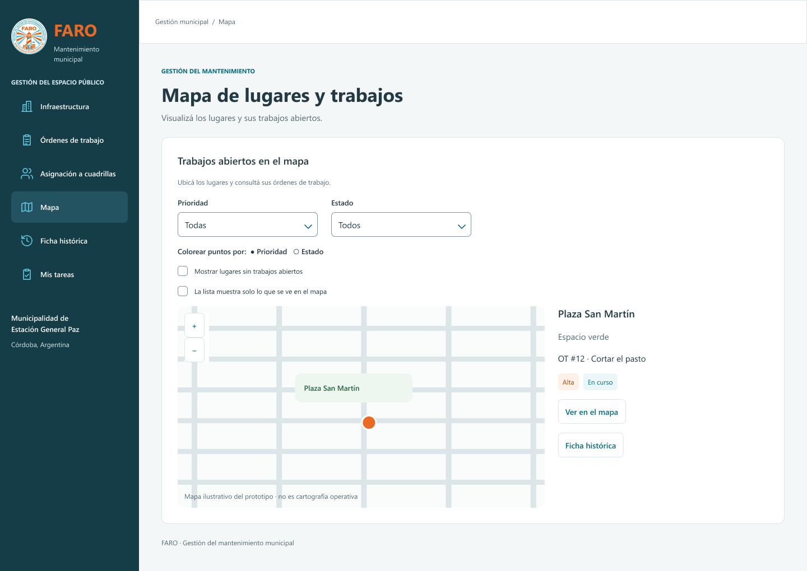
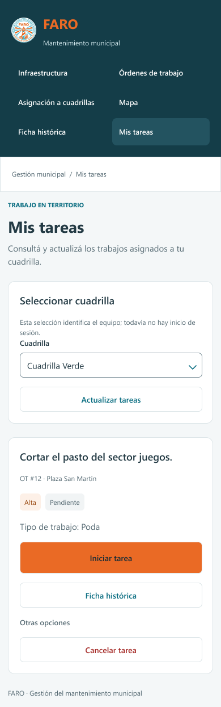

# Pantallas base de FARO en Figma

**Estado: diseño completado; pendiente de revisión y aceptación del equipo y del Scrum Master.**

Archivo editable: [FARO · Pantallas base · Sprint 2](https://www.figma.com/design/3CpJkDaWLjKQ9ARTw8Gkjp).
Tarea del Sprint 2: [Diseño de pantallas base en Figma](https://trello.com/c/RLsEt1te).

## Para qué sirve

El archivo reúne las pantallas base y los recorridos de ejemplo que el equipo de frontend puede consultar al continuar el desarrollo. Conserva Segoe UI, el logo original, la paleta institucional y los componentes existentes. Se tomó como referencia `develop` en el commit `2947f6f`, incluido en la consolidación del [PR #26](https://github.com/mayex-gif/Faro/pull/26).

La referencia de estilos de la aplicación sigue siendo [GUIA_ESTILOS.md](../GUIA_ESTILOS.md). Figma contiene el diseño editable y el prototipo; GitHub conserva el alcance, los enlaces y las evidencias. Esta entrega documenta el diseño y no modifica las funcionalidades de la aplicación.

## Pantallas incluidas

Los seis módulos tienen una vista base de escritorio de 1440 × 1000 px y una versión nativa de celular de 390 × 844 px. El contenido continúa mediante desplazamiento vertical; las tablas conservan sus columnas y se desplazan dentro de su panel.

| Módulo | Escritorio | Celular |
|---|---|---|
| Infraestructura | [Registrar, consultar y editar lugares](https://www.figma.com/design/3CpJkDaWLjKQ9ARTw8Gkjp?node-id=28-1748) | [Versión de celular](https://www.figma.com/design/3CpJkDaWLjKQ9ARTw8Gkjp?node-id=28-5141) |
| Órdenes de trabajo | [Registro, listado y filtros](https://www.figma.com/design/3CpJkDaWLjKQ9ARTw8Gkjp?node-id=28-1940) | [Versión de celular](https://www.figma.com/design/3CpJkDaWLjKQ9ARTw8Gkjp?node-id=28-5328) |
| Asignación a cuadrillas | [Asignación y reasignación](https://www.figma.com/design/3CpJkDaWLjKQ9ARTw8Gkjp?node-id=28-2168) | [Versión de celular](https://www.figma.com/design/3CpJkDaWLjKQ9ARTw8Gkjp?node-id=28-5550) |
| Mapa | [Lugares y trabajos abiertos](https://www.figma.com/design/3CpJkDaWLjKQ9ARTw8Gkjp?node-id=28-2306) | [Versión de celular](https://www.figma.com/design/3CpJkDaWLjKQ9ARTw8Gkjp?node-id=28-5687) |
| Ficha histórica | [Resumen e historial del lugar](https://www.figma.com/design/3CpJkDaWLjKQ9ARTw8Gkjp?node-id=28-2431) | [Versión de celular](https://www.figma.com/design/3CpJkDaWLjKQ9ARTw8Gkjp?node-id=28-5807) |
| Mis tareas | [Trabajos de la cuadrilla](https://www.figma.com/design/3CpJkDaWLjKQ9ARTw8Gkjp?node-id=28-2544) | [Versión de celular](https://www.figma.com/design/3CpJkDaWLjKQ9ARTw8Gkjp?node-id=28-5917) |

Las pantallas del avance de Sprint 1 se conservan como antecedentes. Las vistas que comienzan con **S2** corresponden a esta entrega y son la referencia actual.

## Cómo revisar el prototipo

Abrir una vista base y usar **Presentar** en Figma. También se puede elegir el flujo de escritorio o celular en la pestaña **Prototype**. Los recorridos permiten:

- Navegar entre los seis módulos.
- Editar un lugar o una orden, cancelar la edición y ver el guardado de ejemplo.
- Aplicar el ejemplo de filtro por prioridad Alta y limpiar los filtros.
- Asignar una cuadrilla y reasignar la orden a otro equipo.
- Abrir la ficha histórica desde el mapa o desde un listado y consultar los ejemplos de historial abierto y cerrado.
- Iniciar una tarea, confirmar su finalización o volver sin finalizarla. También hay un ejemplo de cancelación.
- Consultar ejemplos de carga, error, listado sin coincidencias y validación de formulario.

Los controles simulan recorridos con estados previamente preparados; no son formularios conectados al backend. Los nombres, órdenes, fechas y coordenadas son ficticios. El mapa del prototipo es un esquema vectorial ilustrativo: la cartografía operativa pertenece a la aplicación. Estos límites permiten revisar la interfaz sin afectar datos reales.

[Inicio del prototipo de escritorio](https://www.figma.com/proto/3CpJkDaWLjKQ9ARTw8Gkjp?node-id=28-9834&page-id=0%3A1&starting-point-node-id=28%3A9834&scaling=scale-down)
· [Inicio del prototipo de celular](https://www.figma.com/proto/3CpJkDaWLjKQ9ARTw8Gkjp?node-id=28-8988&page-id=13%3A476&starting-point-node-id=28%3A8988&scaling=scale-down)

## Pautas para continuar el frontend

| Elemento | Pauta común |
|---|---|
| Paleta | Naranja `#EA6A25`, cian `#1B9FB5`, celeste `#5FC0D8`, blanco `#FFFFFF`; colores de apoyo de la guía |
| Tipografía | Segoe UI Regular, Semibold y Bold; títulos de 34 px en escritorio y 28 px en celular |
| Controles | Altura mínima de 44 px; acción principal de tareas de 56 px |
| Espaciado | Reutilizar 8, 16, 24 y 32 px según el contenedor |
| Paneles | Radio de 12 px; controles de 7 px |
| Acciones | Etiqueta clara; acción principal naranja con texto oscuro |
| Estados | Color acompañado de texto; mensajes que explican qué pasó y cómo seguir |
| Celular | Campos en una columna, navegación visible y tablas con desplazamiento horizontal interno |

Reutilizar las instancias de la página **01 · Guía y componentes**. Las pantallas mantienen texto, vectores, contenedores e instancias editables; el logo conserva la imagen original. Las capturas de esta carpeta sirven como evidencia y no reemplazan las capas de Figma.

## Verificación y aceptación

La revisión de esta entrega comprende la organización de capas, la disponibilidad de Segoe UI, la reutilización de variables y componentes, el ajuste de textos y controles, el desplazamiento de contenido y los destinos de las conexiones. Las evidencias se toman después de esa revisión.

Verificación del **12/10/2026**: 28 vistas y estados de escritorio y 28 de celular, incluyendo un índice en cada formato; 232 capas con interacción en cada formato; Segoe UI como única familia de texto en las nuevas vistas; sin desbordes horizontales fuera de contenedores desplazables en la comprobación estructural. Se revisaron las exportaciones de los módulos y se probó en modo Presentar el recorrido de celular **Iniciar tarea → En curso → Confirmar finalización → Tarea finalizada**, además del desplazamiento vertical. Las doce exportaciones corresponden a las vistas base completas, no solamente al primer tramo visible de la ventana.

La aceptación del equipo y del Scrum Master queda pendiente. El PR de documentación permite revisar el alcance y las evidencias antes de incorporarlos a `develop`. La entrega no implica cerrar otras tareas del Sprint 2 ni agregar funcionalidades de iteraciones posteriores.

## Evidencias

Las exportaciones incluidas muestran el estado de diseño de esta entrega. Para revisar interacciones y contenido desplazable, usar el archivo editable y el modo Presentar.

| Módulo | Escritorio | Celular |
|---|---|---|
| Infraestructura | [Captura](sprint2/infraestructura-escritorio.png) | [Captura](sprint2/infraestructura-celular.png) |
| Órdenes de trabajo | [Captura](sprint2/ordenes-escritorio.png) | [Captura](sprint2/ordenes-celular.png) |
| Asignación a cuadrillas | [Captura](sprint2/cuadrillas-escritorio.png) | [Captura](sprint2/cuadrillas-celular.png) |
| Mapa | [Captura](sprint2/mapa-escritorio.png) | [Captura](sprint2/mapa-celular.png) |
| Ficha histórica | [Captura](sprint2/historia-escritorio.png) | [Captura](sprint2/historia-celular.png) |
| Mis tareas | [Captura](sprint2/tareas-escritorio.png) | [Captura](sprint2/tareas-celular.png) |

[Evidencia del recorrido verificado en Presentar](sprint2/prototipo-verificado.png).
