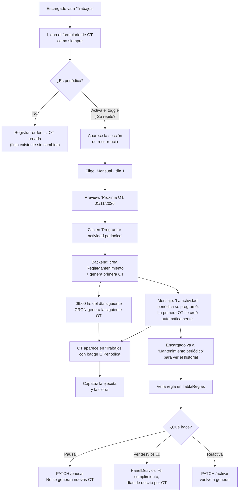

# Frontend pendiente — Motor de Mantenimiento Periódico (Módulo 10)

> **Enfoque adoptado:** el encargado configura actividades periódicas **directamente desde el formulario de OT**,
> activando un toggle "¿Se repite periódicamente?". No hay una sección separada para crear reglas;
> la gestión y monitoreo de las reglas existentes vive en una pantalla simple de solo lectura + acciones.

---

## ¿Qué es una "actividad periódica" y cómo se crearía?

Hoy el encargado crea una OT yendo a **"Trabajos" → formulario "Registrar una orden de trabajo"**.

Con este módulo, ese mismo formulario gana una sección extra al pie: **"¿Se repite periódicamente?"**

```
┌─────────────────────────────────────────────────────────────────┐
│  Registrar una orden de trabajo                                 │
├─────────────────────────────────────────────────────────────────┤
│  [campos existentes: descripción, tipo, lugar, prioridad...]    │
│                                                                 │
│  ─── ¿Se repite periódicamente? ────────────────────────────   │
│                                                                 │
│  [ ] Sí, es una actividad que se repite  ← toggle/checkbox     │
│                                                                 │
│  ↓ (al activar, aparece)                                        │
│                                                                 │
│  Frecuencia *      Cada cuántos/as *   Fecha de fin (opcional)  │
│  [Mensual ▾]       [1]                 [          ]             │
│                                                                 │
│  Día del mes *    ← solo si MENSUAL                             │
│  [1]                                                            │
│                                                                 │
│  Día de la semana *  ← solo si SEMANAL                          │
│  [Lunes ▾]                                                      │
│                                                                 │
│  ℹ La próxima OT se creará automáticamente el 01/11/2026       │
│                                                                 │
│                              [Registrar orden y programar]      │
└─────────────────────────────────────────────────────────────────┘
```

Al guardar con el toggle activado, el backend hace **dos cosas en secuencia**:
1. Crea la `ReglaMantenimiento` (la configuración de recurrencia)
2. Genera la primera OT vinculada a esa regla (con `reglaMantenimientoId` y `fechaPlanificada`)

Desde entonces, el motor CRON genera las siguientes OT solo, a las 06:00 hs de cada día configurado.

---

## Qué existe hoy vs. qué falta

| Capa | ¿Existe hoy? | ¿Qué falta? |
|------|-------------|------------|
| **Backend** | ✅ Completo (`feature/motor-mantenimiento-periodico-backend`) | — |
| **API JS** (`/api/`) | ❌ | Archivo `mantenimiento.js` |
| **FormularioOrden.jsx** | ✅ Existe, hay que extenderlo | Sección de recurrencia + lógica de envío en dos pasos |
| **Página de gestión** | ❌ | `PaginaMantenimiento.jsx` (solo para ver/pausar/ver desvíos) |
| **Tabla de reglas** | ❌ | `TablaReglas.jsx` |
| **Panel de desvíos** | ❌ | `PanelDesvios.jsx` |
| **Navegación** | ❌ | Agregar `'mantenimiento'` a `navegacion.js`, `App.jsx`, `permisos.js` |
| **TablaOrdenes.jsx** | ✅ Existe | Badge "🔄 Periódica" en OT con `reglaMantenimientoId` |

---

## Arquitectura de archivos

```
frontend/src/
├── api/
│   └── mantenimiento.js              ← NUEVO
├── pages/
│   └── PaginaMantenimiento.jsx       ← NUEVO (gestión/monitoreo de reglas, no creación)
├── components/
│   ├── FormularioOrden.jsx           ← MODIFICAR: agregar sección de recurrencia al pie
│   ├── SeccionRecurrencia.jsx        ← NUEVO: bloque colapsable de recurrencia (extraído)
│   ├── TablaReglas.jsx               ← NUEVO: lista de reglas existentes con acciones
│   └── PanelDesvios.jsx             ← NUEVO: resumen planificado vs ejecutado
└── utils/
    └── mantenimiento.js              ← NUEVO: constantes de frecuencias, helpers de fecha
```

Archivos existentes a modificar:

```
App.jsx                  ← registrar PaginaMantenimiento
utils/navegacion.js      ← agregar 'mantenimiento' a MAS[]
utils/permisos.js        ← agregar 'mantenimiento' a VISTAS_POR_ROL[ENCARGADO]
components/TablaOrdenes.jsx ← badge "🔄 Periódica"
```

---

## Especificación de cada archivo

---

### `api/mantenimiento.js`

```js
// Funciones para hablar con el backend del Motor de Mantenimiento Periódico.
import { pedir } from './cliente'

const RUTA = '/mantenimiento-reglas'

// Listar reglas. Parámetros opcionales: activa (bool), lugarId (number)
export function listarReglas({ activa, lugarId } = {}) {
  const params = new URLSearchParams()
  if (activa !== undefined) params.set('activa', activa)
  if (lugarId)              params.set('lugarId', lugarId)
  return pedir(`${RUTA}?${params}`)
}

export function crearRegla(datos)          { return pedir(RUTA, { method: 'POST', body: JSON.stringify(datos) }) }
export function actualizarRegla(id, datos) { return pedir(`${RUTA}/${id}`, { method: 'PUT', body: JSON.stringify(datos) }) }
export function pausarRegla(id)            { return pedir(`${RUTA}/${id}/pausar`, { method: 'PATCH' }) }
export function activarRegla(id)           { return pedir(`${RUTA}/${id}/activar`, { method: 'PATCH' }) }
export function eliminarRegla(id)          { return pedir(`${RUTA}/${id}`, { method: 'DELETE' }) }
export function ejecutarRegla(id, fecha)   { return pedir(`${RUTA}/${id}/ejecutar${fecha ? `?fecha=${fecha}` : ''}`, { method: 'POST' }) }
export function desviosPorRegla(id)        { return pedir(`${RUTA}/${id}/desvios`) }
export function desviosGlobales()          { return pedir(`${RUTA}/desvios`) }
```

---

### `utils/mantenimiento.js`

```js
// Constantes y helpers para el Motor de Mantenimiento Periódico.
// Sigue el patrón de utils/ordenesTrabajo.js (arrays de { valor, etiqueta }).

export const FRECUENCIAS = [
  { valor: 'DIARIA',  etiqueta: 'Diaria'  },
  { valor: 'SEMANAL', etiqueta: 'Semanal' },
  { valor: 'MENSUAL', etiqueta: 'Mensual' },
]

export const DIAS_SEMANA = [
  { valor: 1, etiqueta: 'Lunes'    },
  { valor: 2, etiqueta: 'Martes'   },
  { valor: 3, etiqueta: 'Miércoles'},
  { valor: 4, etiqueta: 'Jueves'   },
  { valor: 5, etiqueta: 'Viernes'  },
  { valor: 6, etiqueta: 'Sábado'   },
  { valor: 7, etiqueta: 'Domingo'  },
]

// Calcula la próxima fecha de ejecución en el frontend para mostrar el preview.
// Replica la lógica de CalculadorRecurrencia.java.
export function calcularProximaFecha({ frecuencia, intervalo = 1, diaSemana, diaMes, fechaInicio }) {
  const hoy = new Date()
  let base = fechaInicio ? new Date(fechaInicio) : hoy
  if (base < hoy) base = hoy

  if (frecuencia === 'DIARIA') {
    // devuelve base tal cual (o ajusta por intervalo si ya pasó)
    return base
  }
  if (frecuencia === 'SEMANAL' && diaSemana) {
    // avanza hasta el próximo día de semana pedido
    const diasHastaProximo = (diaSemana - 1 - base.getDay() + 7) % 7 || 7
    base.setDate(base.getDate() + diasHastaProximo)
    return base
  }
  if (frecuencia === 'MENSUAL' && diaMes) {
    base.setDate(diaMes)
    if (base < hoy) base.setMonth(base.getMonth() + intervalo)
    return base
  }
  return null
}

// "Mensual · día 1" / "Semanal · Lunes" / "Diaria · cada 2 días"
export function etiquetaFrecuencia({ frecuencia, intervalo = 1, diaSemana, diaMes }) {
  if (frecuencia === 'MENSUAL')  return `Mensual · día ${diaMes}`
  if (frecuencia === 'SEMANAL')  return `Semanal · ${DIAS_SEMANA.find(d => d.valor === diaSemana)?.etiqueta ?? ''}`
  if (intervalo === 1) return 'Diaria'
  return `Diaria · cada ${intervalo} días`
}
```

---

### `components/SeccionRecurrencia.jsx` ← el bloque nuevo dentro del formulario de OT

Este componente es el corazón del cambio. Se agrega **al pie de `FormularioOrden`**,
justo antes de los botones "Cancelar / Registrar orden".

```jsx
// Props:
//  recurrencia: { activa, frecuencia, intervalo, diaSemana, diaMes, fechaInicio, fechaFin }
//  onChange(campos): actualiza el estado en FormularioOrden
//  errores: { frecuencia, diaSemana, diaMes, ... }
function SeccionRecurrencia({ recurrencia, onChange, errores }) {
  const { activa, frecuencia, intervalo, diaSemana, diaMes, fechaFin } = recurrencia
  const proximaFecha = activa ? calcularProximaFecha(recurrencia) : null

  return (
    <section className="seccion-formulario" aria-labelledby="titulo-recurrencia">
      <h3 id="titulo-recurrencia">¿Se repite periódicamente?</h3>

      {/* Toggle principal */}
      <label className="campo-toggle">
        <input type="checkbox" checked={activa}
          onChange={e => onChange({ activa: e.target.checked })} />
        Sí, es una actividad que se repite
      </label>

      {/* Campos que aparecen solo cuando el toggle está activado */}
      {activa && (
        <div className="campos">
          <div className="campo">
            <label htmlFor="frecuencia">Frecuencia *</label>
            <select id="frecuencia" value={frecuencia}
              onChange={e => onChange({ frecuencia: e.target.value, diaSemana: '', diaMes: '' })}>
              <option value="">Elegí la frecuencia…</option>
              {FRECUENCIAS.map(f => <option key={f.valor} value={f.valor}>{f.etiqueta}</option>)}
            </select>
          </div>

          <div className="campo">
            <label htmlFor="intervalo">Cada cuántos/as</label>
            <input id="intervalo" type="number" min="1" value={intervalo}
              onChange={e => onChange({ intervalo: Number(e.target.value) })} />
          </div>

          {/* Solo si SEMANAL */}
          {frecuencia === 'SEMANAL' && (
            <div className="campo">
              <label htmlFor="diaSemana">Día de la semana *</label>
              <select id="diaSemana" value={diaSemana}
                onChange={e => onChange({ diaSemana: Number(e.target.value) })}>
                <option value="">Elegí el día…</option>
                {DIAS_SEMANA.map(d => <option key={d.valor} value={d.valor}>{d.etiqueta}</option>)}
              </select>
            </div>
          )}

          {/* Solo si MENSUAL */}
          {frecuencia === 'MENSUAL' && (
            <div className="campo">
              <label htmlFor="diaMes">Día del mes (1-31) *</label>
              <input id="diaMes" type="number" min="1" max="31" value={diaMes}
                onChange={e => onChange({ diaMes: Number(e.target.value) })} />
            </div>
          )}

          <div className="campo">
            <label htmlFor="fechaFin">Fecha de fin (opcional)</label>
            <input id="fechaFin" type="date" value={fechaFin}
              onChange={e => onChange({ fechaFin: e.target.value })} />
            <p className="ayuda-campo">Si no se completa, la regla se repite indefinidamente.</p>
          </div>

          {/* Preview dinámico */}
          {proximaFecha && (
            <p className="ayuda-campo recurrencia-preview">
              ℹ La próxima OT se creará automáticamente
              el <strong>{proximaFecha.toLocaleDateString('es-AR')}</strong>
            </p>
          )}
        </div>
      )}
    </section>
  )
}
```

---

### Cambios en `FormularioOrden.jsx`

Es el archivo más importante a modificar. Los cambios son **quirúrgicos**: se agrega estado
para recurrencia y se modifica solo la función `enviar()`.

**Estado nuevo (agregar junto a los existentes):**

```js
// Estado de recurrencia — arranca desactivado
const RECURRENCIA_VACIA = {
  activa: false, frecuencia: '', intervalo: 1,
  diaSemana: '', diaMes: '', fechaInicio: hoy(), fechaFin: ''
}
const [recurrencia, setRecurrencia] = useState(RECURRENCIA_VACIA)

// Actualización parcial de la recurrencia (igual que setDatos)
function cambiarRecurrencia(campos) {
  setRecurrencia(anterior => ({ ...anterior, ...campos }))
}
```

**Lógica de envío modificada (función `enviar`):**

```js
// Si la recurrencia está activa: primero creamos la regla, luego el backend
// genera la primera OT automáticamente y devuelve el ordenId.
// Si no: flujo existente sin cambios.
async function enviar(evento) {
  evento.preventDefault()
  const encontrados = validar()
  // validar también los campos de recurrencia si está activa
  if (recurrencia.activa) {
    if (!recurrencia.frecuencia) encontrados.frecuencia = 'Elegí la frecuencia.'
    if (recurrencia.frecuencia === 'SEMANAL' && !recurrencia.diaSemana)
      encontrados.diaSemana = 'Elegí el día de la semana.'
    if (recurrencia.frecuencia === 'MENSUAL' && !recurrencia.diaMes)
      encontrados.diaMes = 'Ingresá el día del mes.'
  }
  setErrores(encontrados)
  if (Object.keys(encontrados).length > 0) { setError('Revisá los campos marcados.'); return }

  setGuardando(true)
  setError(null)
  try {
    if (recurrencia.activa && !editando) {
      // Crear regla → el backend genera la 1ra OT y devuelve sus datos
      const regla = await crearRegla({
        titulo: datos.descripcion.trim().slice(0, 150),
        descripcion: datos.descripcion.trim(),
        tipoTrabajo: datos.tipo,
        prioridad: datos.prioridad,
        lugarId: Number(datos.lugarId),
        frecuencia: recurrencia.frecuencia,
        intervalo: recurrencia.intervalo || 1,
        diaSemana: recurrencia.diaSemana || null,
        diaMes: recurrencia.diaMes || null,
        fechaInicio: recurrencia.fechaInicio || hoy(),
        fechaFin: recurrencia.fechaFin || null,
      })
      // Disparar la 1ra OT de inmediato
      await ejecutarRegla(regla.id)
      setDatos(FORMULARIO_VACIO)
      setRecurrencia(RECURRENCIA_VACIA)
      onGuardado('La actividad periódica se programó. La primera OT se creó automáticamente.')
    } else {
      // Flujo existente sin recurrencia
      await registrar(orden)
    }
  } catch (e) {
    // manejo de errores idéntico al existente
  } finally {
    setGuardando(false)
  }
}
```

**Texto del botón de submit** (adaptativo):

```jsx
{guardando ? 'Guardando…'
  : editando ? 'Guardar cambios'
  : recurrencia.activa ? 'Programar actividad periódica'
  : 'Registrar orden'}
```

**Agregar `<SeccionRecurrencia>` en el JSX**, justo antes del `<div className="formulario-pie">`:

```jsx
{/* Solo el encargado puede configurar recurrencia, no en modo edición */}
{puedeAsignar(usuario) && !editando && (
  <SeccionRecurrencia
    recurrencia={recurrencia}
    onChange={cambiarRecurrencia}
    errores={errores}
  />
)}
```

> [!NOTE]
> En modo **edición** de una OT existente, la sección de recurrencia no aparece.
> Para modificar la regla de una OT periódica, se va a la pantalla "Mantenimiento periódico".

---

### `components/TablaOrdenes.jsx` — badge en OT periódicas

```jsx
// En la celda donde se muestra la descripción de la OT, agregar:
{orden.reglaMantenimientoId && (
  <span className="badge badge-periodica"
    title="Generada automáticamente por mantenimiento periódico">
    🔄 Periódica
  </span>
)}
```

---

### `pages/PaginaMantenimiento.jsx` — solo gestión, no creación

Esta página es **solo para el encargado** y tiene un propósito diferente al del formulario:
permite **ver, pausar, reactivar y monitorear** las reglas ya existentes.
No tiene formulario de creación (eso está en "Trabajos").

**Layout:**

```
MANTENIMIENTO PERIÓDICO
Actividades programadas

Acá podés ver las actividades que se generan automáticamente, pausarlas
o ver si se ejecutaron a tiempo.
Para crear una nueva actividad periódica, usá el formulario de Trabajos
y activá la opción "¿Se repite periódicamente?".

[Filtros: Activas / Pausadas / Lugar]

TablaReglas
  ↳ cada fila expandible → PanelDesvios

─── Reporte global ──────────────────────
PanelDesvios (todas las reglas consolidadas)
```

---

### `components/TablaReglas.jsx`

**Columnas:**

| Columna | Contenido |
|---------|-----------|
| Actividad | Título |
| Lugar | Nombre |
| Se repite | "Mensual · día 1" / "Semanal · Lunes" / "Diaria" |
| Próxima OT | `proximaEjecucion` formateada |
| Estado | Badge verde `● Activa` / gris `⏸ Pausada` |
| Acciones | [Pausar / Activar] [Ver desvíos ▸] [Eliminar] |

**Wireframe:**

```
Mostrando 3 de 3 actividades programadas

┌───────────────────┬──────────────┬──────────────┬────────────┬──────────┬──────────────────┐
│ Actividad         │ Lugar        │ Se repite    │ Próxima OT │ Estado   │ Acciones         │
├───────────────────┼──────────────┼──────────────┼────────────┼──────────┼──────────────────┤
│ Revisión mensual  │ Plazoleta    │ Mensual · 1  │ 01/11/2026 │ ●Activa  │ [⏸ Pausar] [📊]  │
│ de bombas         │ Central      │              │            │          │                  │
├───────────────────┼──────────────┼──────────────┼────────────┼──────────┼──────────────────┤
│ Barrido veredas   │ Av. San      │ Semanal      │ 03/11/2026 │ ⏸Pausada │ [▶ Activar] [📊] │
│                   │ Martín       │ Lunes        │            │          │                  │
└───────────────────┴──────────────┴──────────────┴────────────┴──────────┴──────────────────┘
```

---

### `components/PanelDesvios.jsx`

Se expande al hacer clic en el botón `📊` de una fila. Consume `GET /{id}/desvios`.

**Wireframe:**

```
▼ Desvíos — Revisión mensual de bombas pluviales

  Total   A tiempo   Demoradas   Pendientes   Cumplimiento
    12        8           3           1           66.7%

  Promedio de desvío: +2.3 días

  OT       Planificada    Ejecutada     Desvío
  #42      01/10/2026     03/10/2026    +2 días  ⚠
  #38      01/09/2026     01/09/2026    A tiempo  ✓
  #31      01/08/2026     29/07/2026    -2 días  ↑
  #27 ⏳   01/11/2026     —             Pendiente
```

**Colores:**
- `A_TIEMPO` → verde
- `DEMORADA` → naranja
- `ADELANTADA` → azul
- `PENDIENTE` → gris (cursiva)
- `CANCELADA` → tachado

---

## Flujo completo desde la perspectiva del usuario



---

## Modificaciones a archivos existentes

### `utils/navegacion.js`
```js
// Agregar a MAS[]:
{ clave: 'mantenimiento', titulo: 'Mantenimiento periódico', icono: 'calendario' }
// NO agregar a NUEVO[]: la creación se hace desde el formulario de OT
```

### `utils/permisos.js`
```js
[ENCARGADO]: [...existentes, 'mantenimiento'],

// Nueva función:
export function puedeGestionarMantenimiento(usuario) {
  return tieneRol(usuario, ENCARGADO)
}
```

### `App.jsx`
```js
import PaginaMantenimiento from './pages/PaginaMantenimiento'
const PAGINAS = { ...existentes, mantenimiento: PaginaMantenimiento }
```

---

## Comparación de enfoques

| | ❌ Sección separada (descartado) | ✅ Toggle en el formulario (adoptado) |
|---|---|---|
| Flujo del usuario | Va a otra sección, aprende nuevo formulario | Mismo formulario de siempre, una opción más |
| Descubrimiento | "¿Dónde creo una actividad periódica?" | Aparece naturalmente al crear una OT |
| Contexto | El encargado tiene que recordar todos los campos de nuevo | Ya completó lugar, tipo, prioridad: solo agrega "¿se repite?" |
| Pantalla de gestión | Sirve para todo | Solo sirve para monitorear y pausar |
| Complejidad frontend | Alta (página nueva + formulario nuevo) | Media (extender el existente) |

---

## Criterios de aceptación

### `SeccionRecurrencia` dentro de `FormularioOrden`
- [ ] El toggle arranca en "No" (desactivado)
- [ ] Al activar el toggle, aparecen los campos de recurrencia
- [ ] `diaSemana` aparece solo si `frecuencia === 'SEMANAL'`
- [ ] `diaMes` aparece solo si `frecuencia === 'MENSUAL'`
- [ ] El preview "La próxima OT se creará el DD/MM/AAAA" se actualiza en tiempo real
- [ ] La sección **no aparece** al editar una OT existente
- [ ] La sección **no aparece** para roles MESA ni CAPATAZ
- [ ] Al guardar con recurrencia: el botón dice "Programar actividad periódica"
- [ ] Al guardar exitosamente: mensaje diferenciado de la OT simple

### `TablaReglas`
- [ ] Badge "● Activa" / "⏸ Pausada" visualmente distintos
- [ ] Pausar/activar actualiza la fila sin recargar toda la lista
- [ ] Eliminar: confirmación + muestra el mensaje del backend si tiene OT

### `PanelDesvios`
- [ ] Muestra totales, porcentaje de cumplimiento y promedio de días de desvío
- [ ] Colorea cada OT según su clasificación
- [ ] Funciona como reporte global (sin `reglaId`) y por regla específica

### `TablaOrdenes`
- [ ] Las OT con `reglaMantenimientoId` muestran badge "🔄 Periódica"

---

## Estimación de esfuerzo

| Archivo | Complejidad | Estimado |
|---------|-------------|---------|
| `api/mantenimiento.js` | Baja | 20 min |
| `utils/mantenimiento.js` | Baja | 30 min |
| `SeccionRecurrencia.jsx` | Media | 1.5-2 hs |
| `FormularioOrden.jsx` (modificar) | Media | 1-1.5 hs |
| `TablaReglas.jsx` | Media | 1.5 hs |
| `PanelDesvios.jsx` | Media | 1.5 hs |
| `PaginaMantenimiento.jsx` | Baja-Media | 1 hs |
| Modificaciones menores existentes | Baja | 30 min |
| CSS / estilos | Media | 1 hs |
| **Total estimado** | | **~9-10 hs** |
